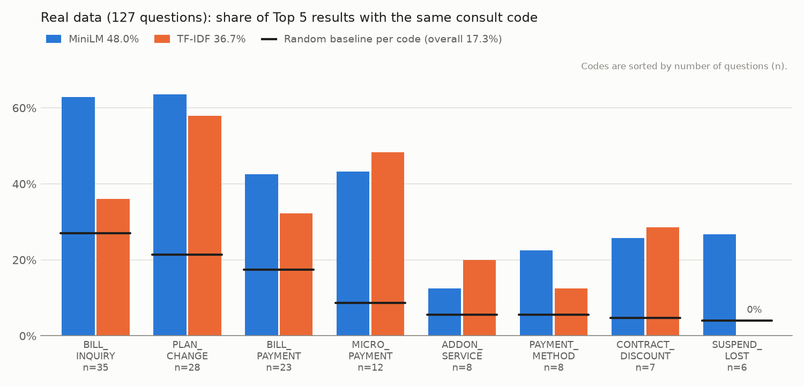

# 표현이 다른 중복 질문 찾기

## 협업 규칙

### 작업 순서

1. 담당 Issue 확인
2. `dev`에서 브랜치 생성
3. 작업 후 커밋, push
4. `dev` 대상으로 PR 생성
5. 팀장 승인 후 merge

```bash
git switch dev
git pull origin dev
git switch -c feat/search-7
```

### 브랜치

`type/작업내용-이슈번호`

```text
feat/search-7
fix/embedding-load-21
docs/readme-17
```

### 커밋

`type: 작업 내용 (#이슈번호)`

```text
feat: 유사 질문 Top 5 검색 구현 (#7)
fix: 빈 질문 입력 오류 수정 (#21)
docs: 실행 방법 작성 (#17)
```

| type | 사용 시점 |
|---|---|
| `feat` | 기능, 데이터 처리, 모델, 평가 코드 추가 |
| `fix` | 버그 수정 |
| `docs` | README, 문서 수정 |
| `test` | 테스트 추가, 수정 |
| `refactor` | 동작 변경 없는 코드 개선 |
| `chore` | 설정, 패키지, 폴더 정리 |

- 메시지는 한글로 작성합니다.
- 커밋 하나에는 작업 하나만 담습니다.
- 본인 담당 코드는 본인 계정으로 커밋합니다.

### PR

- 제목: 커밋과 같은 형식
- 대상 브랜치: `dev`
- 본문: 작업 내용과 `Closes #이슈번호`
- merge: 팀장 승인 후 팀장이 진행
- `main`에는 직접 push하지 않습니다.

## 평가

### 방법

- 비교 대상: MiniLM(`paraphrase-multilingual-MiniLM-L12-v2`, 앱과 같은 revision) vs TF-IDF(글자 2~4개 단위)
- 실행: `python -m eval.evaluate`
- **샘플 30개** (`data/sample_questions.csv`, 직접 만든 통신 상담 질문, 같은 의미 묶음 14개)
  - 질문 하나씩 넣고 나머지 29개에서 검색
  - Top 1 정확도: 1등이 같은 묶음인 비율 / Top 5 포함률: 5개 안에 같은 묶음이 하나라도 있는 비율
- **실데이터 127건** (AI Hub 통신 상담에서 뽑아 사람이 검수한 질문)
  - 같은 의미 정답이 없어서, 질문 하나씩 넣고 나머지에서 Top 5를 검색했을 때 **같은 상담 코드의 비율**로 평가
  - 실데이터는 저장소에 올리지 않으므로, 데이터를 가진 팀원 컴퓨터에서 1번 실행한 숫자만 기록
- 무작위: 검색 없이 무작위로 골랐을 때의 기댓값 (비교 기준)

### 결과

**샘플 30개 (같은 의미 묶음 기준)**

| 방법 | Top 1 정확도 | Top 5 포함률 |
| --- | ---: | ---: |
| MiniLM | 20.0% (6/30) | 33.3% (10/30) |
| TF-IDF | 10.0% (3/30) | 60.0% (18/30) |
| 무작위 | 4.1% | 20.2% |

**실데이터 127건 (Top 5 중 같은 상담 코드 비율)**

| 방법 | 같은 상담 코드 비율 |
| --- | ---: |
| MiniLM | **48.0%** |
| TF-IDF | 36.7% |
| 무작위 | 17.3% |



| 상담 코드 | 질문 수 | MiniLM | TF-IDF | 무작위 |
| --- | ---: | ---: | ---: | ---: |
| BILL_INQUIRY | 35 | 62.9% | 36.0% | 27.0% |
| PLAN_CHANGE | 28 | 63.6% | 57.9% | 21.4% |
| BILL_PAYMENT | 23 | 42.6% | 32.2% | 17.5% |
| MICRO_PAYMENT | 12 | 43.3% | 48.3% | 8.7% |
| ADDON_SERVICE | 8 | 12.5% | 20.0% | 5.6% |
| PAYMENT_METHOD | 8 | 22.5% | 12.5% | 5.6% |
| CONTRACT_DISCOUNT | 7 | 25.7% | 28.6% | 4.8% |
| SUSPEND_LOST | 6 | 26.7% | 0.0% | 4.0% |

상담 코드별 무작위 값은 (그 코드의 질문 수 − 1) ÷ (전체 질문 수 − 1)입니다.

### 결과 해석

**1. 샘플에서는 TF-IDF, 실데이터에서는 MiniLM이 앞선 이유**

- 샘플은 일부러 어려운 짝을 넣어 만든 시험 문제입니다. "요금제 바꾸고 싶어요"와 "요금 납부일을 바꾸고 싶어요"처럼 표현은 거의 같은데 답이 다른 질문이 많습니다.
- 샘플 기준은 "같은 의미 묶음"이라 엄격합니다. 같은 상담 코드여도 요청이 다르면 틀린 것으로 셉니다. 상담 코드만 보면 1등이 같은 코드인 질문은 MiniLM 16/30, TF-IDF 15/30으로 거의 같습니다.
- TF-IDF는 "소액결제", "부가서비스"처럼 핵심 단어가 겹치는 질문을 5개 안에 잘 넣습니다. 그래서 Top 5 포함률이 높습니다. (G10~G13 질문 8개는 모두 같은 묶음 질문이 5개 안에 있음)
- MiniLM은 짧은 문장에서 "~해 주세요", "~하고 싶어요" 같은 문장 끝 표현이나 "휴대폰/폰" 같은 단어에 끌리는 경우가 있었습니다. 예를 들어 "이번 달 청구 금액 확인해 주세요"의 1등이 "폰 분실 신고하고 정지해 주세요"였습니다.
- 실데이터는 실제 고객 말이라 같은 업무라도 쓰는 단어가 제각각입니다. 글자가 겹치는지를 보는 TF-IDF보다 문장 전체의 뜻을 보는 MiniLM이 같은 업무끼리 더 잘 모은 것으로 보입니다. 기준도 "같은 상담 코드"로 샘플보다 느슨합니다.

**2. 질문 수가 적은 코드(8건 이하)의 결과가 낮은 이유**

- **같은 코드 후보 자체가 적습니다.** SUSPEND_LOST(6건)는 나머지 126개 중 같은 코드가 5개뿐이라 무작위 값이 4.0%이고, BILL_INQUIRY(35건)는 27.0%입니다. 숫자 자체는 큰 코드가 유리합니다.
- **무작위 대비로 보면 작은 코드도 잘 찾고 있습니다.** MiniLM 기준 SUSPEND_LOST 26.7%는 무작위의 약 6.7배, CONTRACT_DISCOUNT 25.7%는 약 5.4배로, BILL_INQUIRY(약 2.3배)보다 오히려 높습니다.
- **큰 코드 질문이 Top 5를 채웁니다.** 전체 127건 중 요금 관련 3개 코드(BILL_INQUIRY, PLAN_CHANGE, BILL_PAYMENT)가 86건이라, "요금"이 들어간 작은 코드 질문(PAYMENT_METHOD 등)은 큰 코드 질문에 밀리기 쉬운 것으로 보입니다. 샘플에서도 MiniLM은 PAYMENT_METHOD 질문 4개 모두 1등으로 요금제 변경·요금 납부 질문을 골랐습니다.
- **숫자가 많이 흔들립니다.** 6~8건짜리 코드는 검색 결과 30~40칸으로 계산해서 한 칸이 2.5~3.3%p입니다. 작은 코드끼리의 MiniLM·TF-IDF 차이(예: ADDON_SERVICE 12.5% vs 20.0%, 3칸 차이)는 믿기 어렵습니다.

### 틀린 사례 (샘플)

| 1등이 틀린 유형 | MiniLM | TF-IDF |
| --- | ---: | ---: |
| 같은 상담 코드, 다른 요청 (예: 소액결제 차단 ↔ 한도) | 10 | 12 |
| 다른 상담 코드 (예: 요금제 변경 ↔ 납부일 변경) | 14 | 15 |
| 합계 | 24 | 27 |

질문별 사례는 [`eval/results/sample_errors.md`](eval/results/sample_errors.md)에 있습니다.

### 한계

- 샘플은 30개, 묶음 14개라 질문 1개 차이가 3.3%p입니다.
- 실데이터는 같은 의미 정답이 없어 상담 코드 일치로 대신 평가했습니다. 같은 코드여도 다른 요청일 수 있어서, 이 숫자는 "같은 질문 찾기" 정확도와 다릅니다.
- 실데이터 127건은 상담 코드가 고르지 않아(35건 ~ 6건) 작은 코드 결과가 불안정합니다.
- 같은 질문 판정 기준값(0.7)은 이번 평가(순위 기준)에 쓰지 않았고 바꾸지 않았습니다. 샘플이 작아 기준값을 믿을 만하게 정하기 어려우므로, 화면의 "중복" 표시는 참고용입니다.
- 모델은 다국어 MiniLM 하나만 비교했습니다. 한국어 전용 문장 임베딩 모델을 쓰면 샘플 결과가 나아질 수 있습니다.
